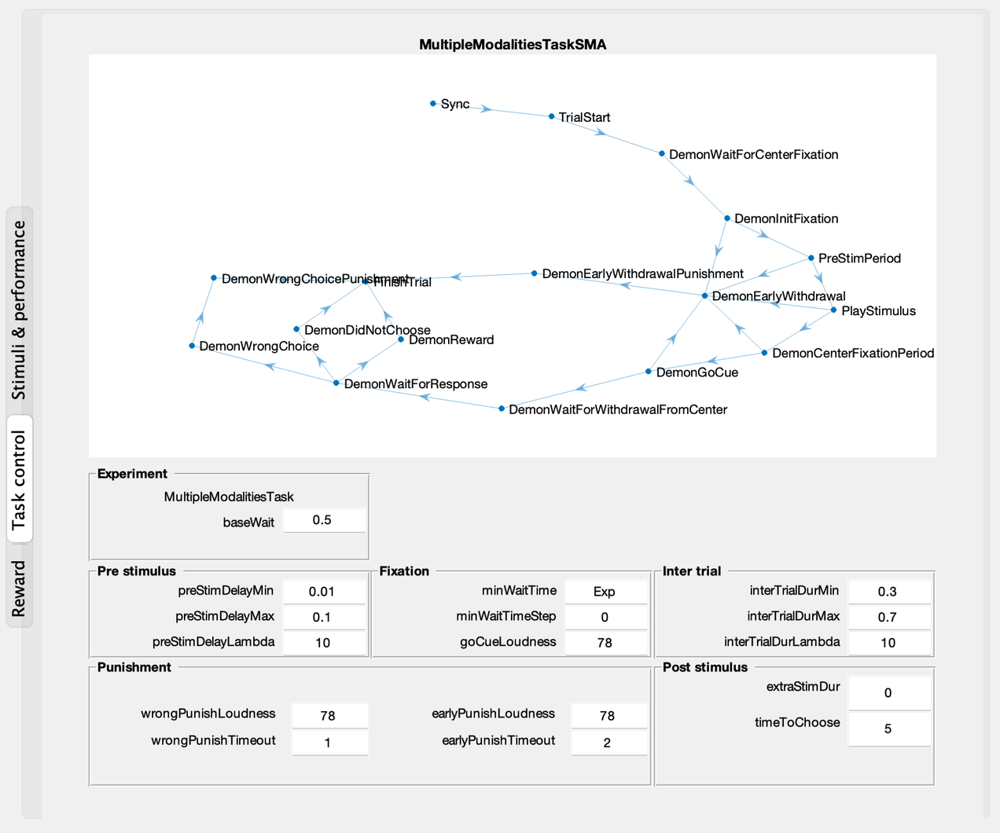
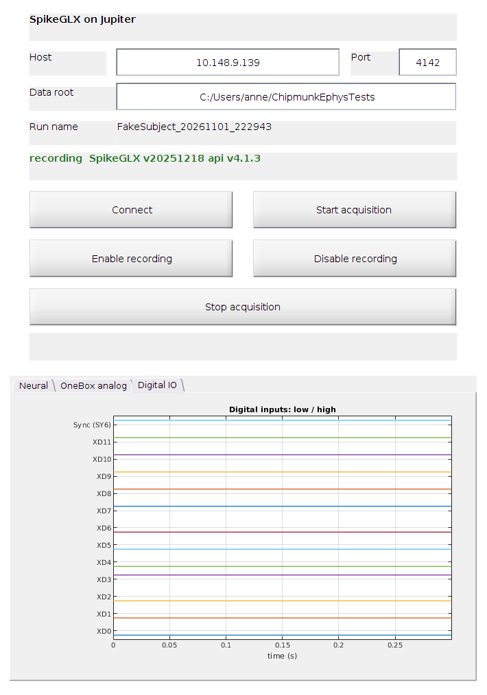
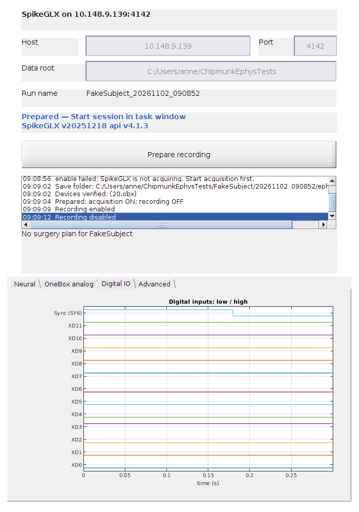
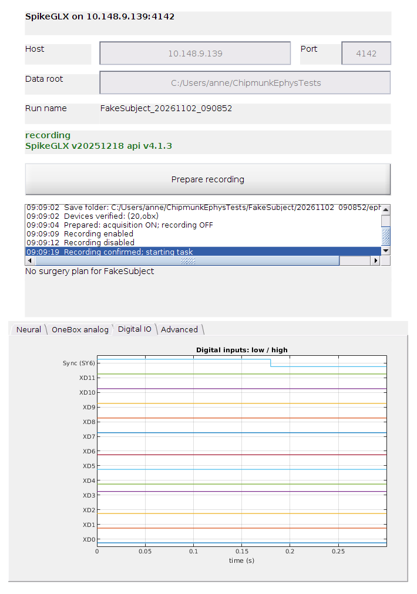
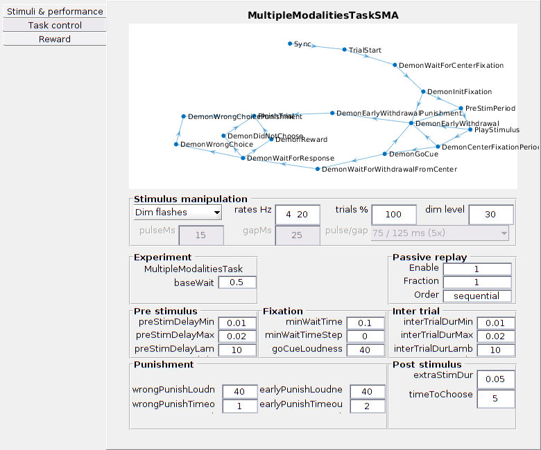
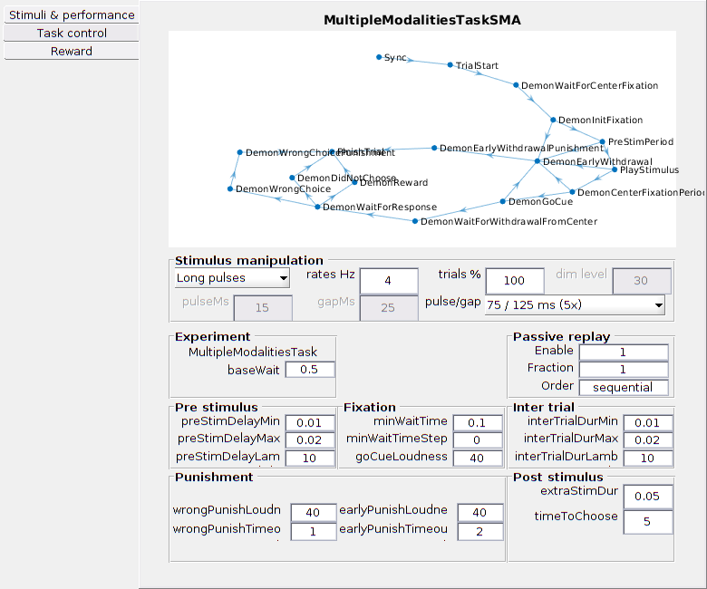
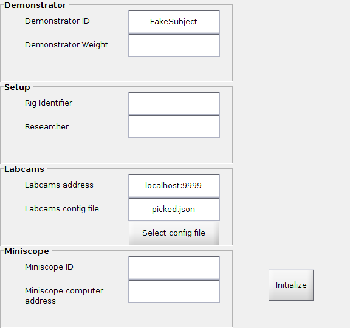

# chipmunk_solo

Freely moving auditory and visual discrimination task for mice (adapted from Raposo et al. 2012). *chipmunk_solo* is an adaptation of *chipmunk*, which can be found at https://github.com/churchlandlab/chipmunk.

## Introduction

This repo contains the code, setup description, assembly instructions, and parts design to build a freely moving behavior setup. The task is a visual and/or auditory accumulation of evidence task. The stimuli are stochastic ticks and/or flashes. `baseWait`, in the Experiment panel, is 0.5 s (the default) or 1 s. With `minWaitTime` set to `exp`, the mouse holds the center port for `baseWait` plus a random extra wait that averages 0.1 s. The `minWaitTime` staircase stops at `baseWait + 0.1`.

## Task window

Screenshots captured on Mercury. The performance view replays GRB006 `20240723_142451`: 831 trials, including 397 completed choices. The outcome panel shows the 200 most recent trials; the performance and psychometric plots use the full session. The Task control view uses saved FakeSubject test settings.

The **Stimuli & performance** tab shows the stimulus, outcomes, performance and psychometric plots. The psychometric legend follows the three modality curves.


The **Task control** tab contains the state diagram, `baseWait`, fixation timing and trial delays.



### Check the psychometric plot

From the repository root, in a fresh MATLAB session:

```matlab
addpath('tests');
check_psychometric_plot;
```

This checks tabbed legend rendering, resizing, modality-specific probabilities and unequal frequency counts without connecting Bpod hardware.

### Stimulus manipulation and settings notes

The Task control panel has four presets. Standard retains the normal stimulus. Dim flashes selects the entered percentage of eligible rates and uses the dim brightness without changing the session's normal brightness. Long pulses selects eligible trials and uses the 75 ms pulse / 125 ms minimum interval combination; rates above its 5 Hz capacity retain normal pulses. Equalized luminance scales brightness by the lowest configured positive rate divided by the trial rate. This equalizes rate × brightness in the control values; physical luminance still requires calibration.

Manipulation presets require the Poisson generator (`isPoissonStim = 1`). Normal pulse and gap values are displayed read-only. Dim exposes eligible rates, trial percentage and dim brightness; Long exposes eligible rates, trial percentage and the supported pulse/gap combination. Standard and Equalized disable controls they do not use. Switching the menu does not change an already prepared trial: click Update settings, and the change takes effect when the next trial is prepared. Save settings also requests an update and retains the configuration for future sessions.

Each completed trial saves the effective values in `StimulusBrightness`, `StimulusDuration` and `MinInterval`, in seconds for the duration fields. `TrialSettings(trial).stimBrightness` also retains the effective brightness used for reconstruction. The session baseline is preserved. Settings changes are recorded in `SettingsNotes` at the trial where they take effect, merged with notebook text in `Notes`, and written to `notes.txt` at shutdown. Trials without notes are omitted. These lines describe configuration changes, not observed mouse behavior.

In a fresh MATLAB session, run the focused regression checks:

```matlab
addpath('tests');
check_stimulus_manipulation;
```

In a fresh, idle Bpod emulator session, run:

```matlab
addpath('tests');
check_chipmunk_manipulation_session(fullfile(tempdir, 'manipulation-session-check'));
```

This drives real GUI callbacks through eight visual FakeSubject trials: Standard, Dim, Long and Equalized, followed by eight passive replays. It checks saved parameter values, notes at trials 3/5/7, unchanged active records and reconstruction from source settings. It uses separate test output, synthetic calibration and no cameras or uploads. On Mercury (MATLAB R2022b Update 1, Bpod Console 1.71), the full run passed on 2026-11-01. That run exposed and fixed note helpers treating the live Bpod object as a struct and clearing active data on Update. The corrected run and focused regressions passed. MAT and notes downloads matched their source SHA-256 hashes.

Physical LED/audio/TTL timing and calibrated output are not established by emulation; Mercury emitted ALSA device/underrun warnings. The earlier task-window screenshots predate this panel; current captures follow.

### Startup and repeated-session checks

Use a real subject name or `FakeSubject`. `Virtual` and `Dummy` are rejected before devices start; those names do not enable emulation. Use `Bpod('EMU')` separately for emulation. Closing the initialization window cancels startup and returns Bpod to idle. Session files are written under the first `local_paths` entry in `$HOME/labdata/user_preferences.json` as `{subject}/{YYYYMMDD_HHMMSS}/chipmunk/`. If that file is missing, the Bpod data folder is used.

The selected labcams JSON is passed to the installed CLI as one quoted file argument. An explicit config restarts an already-open labcams app before recording so the selection actually takes effect. Leave the config blank to reuse an already-open app's current configuration. Startup retains the saved config selection; Cancel in the file picker leaves it unchanged.

`check_startup` verifies validation, config quoting, complete GUI metadata and cancellation. `check_chipmunk_replay_session(outputFolder, experiments)` can run a list of consecutive active/passive sessions in the same MATLAB process. Its driver rejects late callbacks from deleted/replaced timers and checks that each session deletes its timer. A bounded natural-completion check is available as `check_chipmunk_replay_session(outputFolder, {'VisualTask'}, '', 3)`; normal Bpod launches still use the 5,000-trial default. Outcome plots stop indexing future trials after the final trial.

### Optional ephys

Leave SpikeGLX host blank for a normal behavior session. Fill it (for example `jupiter.local`) to enable recording controls and hardware-triggered cameras. Port defaults to 4142. The SpikeGLX run name is `ephys`; its normal first recording group is `ephys_g0`. Subject and Bpod session identity belong in the parent folders. Neuropixels files stay on Jupiter; Stop disables recording and stops acquisition before `labdata put` of the Bpod folder.

1. On Jupiter, open **Chipmunk recording tools**. It opens SpikeGLX and checks its command server, leaving acquisition stopped.
2. Initialize the Bpod protocol. In **Devices**, check the probe port/dock rows and **XIO** streams you want to record, or keep **Use current SpikeGLX selection**. Click **Prepare recording** to apply changed or unvalidated device selections using Detect / Verify | Save. An unchanged, validated live selection is reused. Acquisition then starts with recording off.
3. Click **Start session** in the task window. Bpod confirms ephys recording is on, starts configured camera writing, then begins trials. Stop saves a checkpoint of the task data, keeps recording through any requested passive replay, saves the final behavioral data, stops cameras and closes sound, then stops SpikeGLX recording/acquisition last. Shutdown diagnostics are persisted afterward, before the upload prompt.

The **Devices** table shows a Record checkbox, slot, port and dock for each address. Editing a row switches from the current SpikeGLX setup to an explicit selection. XIO is independent of the probe docks; checking it alone records OneBox inputs without neural data. Addresses must first exist in SpikeGLX’s Configure Slots catalog, including both docks if you use Dock 2. Prepare rejects an empty explicit selection; invalid/missing hardware is reported by Detect. Selection is locked during acquisition. The **Advanced** tab retains manual recording controls. An unrelated active run is left untouched. Host, port, data root, devices and anatomy directory are saved in `spikeglx_prefs.mat`.

The title follows the configured host and TCP port. The status separates the SpikeGLX network connection from acquisition and recording; a network connection is not proof that a probe is attached. Probe detection happens during Prepare. The software/API version is available as a status tooltip. Optional surgery-plan overlay status lives in Advanced. The timestamped action log below Prepare records connection, destination, device validation, recording changes, replay and failures. Its final contents are saved as `SessionData.EphysActionLog`; `EphysRecording` records the host, directory and run name. A failed connection is closed and background polling stops contacting it; use **Advanced → Connect** after resolving the recording host’s error. Connection loss does not prove the remote acquisition stopped. The vendored SDK has a two-second initial TCP preflight and does not automatically reconnect an existing socket during a status poll. Normal polling does not add log entries.

**Data root** is the recording computer's root, such as `D:/data`. Bpod creates `<root>/<subject>/<Bpod session timestamp>/` before preparation. SpikeGLX then creates its native `ephys_g0/` recording group there, beside Bpod's `chipmunk/` folder when the session is copied to Hodgkin. Recording a new group manually can advance the native suffix to `ephys_g1`, etc. Ownership checks use both the run name and recording session directory. Existing recordings are not moved. A folder-creation failure blocks acquisition. On Mercury, passwordless SSH to the configured Windows recording host is required; account and key selection live in the rig user's SSH configuration, outside the task repository. Verify the route with `ssh -o BatchMode=yes jupiter.local hostname` after setup.

The Jupiter launcher is in `rig/jupiter/Start-ChipmunkTools.ps1`, with paths configured in `rig-tools.json` using the adjacent example. On a cold launch only, it backs up `_Configs/daq.ini` and changes only `snsRunName` to a unique `Ready_…` placeholder. SpikeGLX validates its saved name before Bpod can assign the real session name; this avoids collisions with an existing recording. It leaves an open SpikeGLX instance unchanged and never starts acquisition. Configure the SpikeGLX command server on the LAN address before use.

`check_ephys_workflow` checks Prepare/Start, delayed recording acknowledgement, failures, repeated names, run ownership and native GUI callbacks using an isolated SDK fixture. `check_ephys` checks that a blank host stays off and that a failed connect is stored rather than thrown. `check_spikeglx_devices` covers all 31 nonempty OneBox dock/XIO combinations and invalid addresses; `check_spikeglx_disconnect` checks failed-handle cleanup and explicit reconnect. `check_ephys_workflow` also covers live validated-device reuse, lost start acknowledgements, disconnected shutdown, recording-loss guards and camera rollback. `check_ephys_shutdown_order` executes the runner cleanup with isolated endpoints to verify that behavioral data is saved before camera/sound cleanup and ephys stops last, including save and sound failures. `check_stimulus_plot_parents` verifies that concurrent ephys redraws cannot steal the stimulus lines. These unit tests do not exercise neural hardware. Recorded-probe simulation and real SDK recovery evidence are in [the probe investigation](tests/evidence/probe-integration-2026-11-02.json).

#### Recording tabs

- **Devices:** select the probe port/dock and independent OneBox XIO streams, or retain the current native SpikeGLX selection. Checkboxes request acquisition; they are not connection indicators. Addresses must exist in Configure Slots. Slot 20 is a OneBox address; SIM slots 40/41 appear only when that setup includes simulated probes.
- **Neural:** a rolling 0.3 s AP-channel overview, refreshed about twice per second and downsampled to about 1 kHz for display. Per-channel median removal and standard-deviation scaling make contrast relative; this is not a calibrated microvolt or spike-quality plot. Native SpikeGLX settings determine what is saved.
- **OneBox analog:** acquired analog inputs from the first OneBox, vertically offset and scaled for display. It does not configure inputs or change recording.
- **Digital IO:** acquired XD0–XD11 and sync SY6 as low/high traces, retaining full sample resolution within each 0.3 s snippet. This is a periodically refreshed monitor, not a continuous event audit.
- **Anatomy:** preview the selected mouse’s source-verified surgery plan before acquisition, as colored atlas-region bands along four shanks. Distances run upward from the probe tip; a dashed 2,500 µm line marks the requested bank reference on each shank. This display marker does not change the IMRO channel/bank selection. Click a band for its region/range. Reload plan refreshes the source while acquisition is stopped. Previewing never starts acquisition or applies labels; Prepare applies compatible labels to SpikeGLX.
- **Advanced:** reconnect to the network command server; manually enable/disable recording or stop this Bpod session's acquisition. Disable recording keeps acquisition on; Stop acquisition ends both. The surgery-plan folder supplies optional native SpikeGLX shank labels, not probe detection or measured anatomy. Switching tabs never starts or stops recording. Closing this window leaves acquisition alone; normal task shutdown owns cleanup.

#### Surgery-plan anatomy

Set **VVASP folder on host** in Advanced to the shared recording-host folder, normally `D:/VVASP` on Jupiter. `experiments/` contains the original VVASP JSON records; `anatomy/` contains the corresponding atlas-derived profiles generated by `tools/export_vvasp_anatomy.py`. The Anatomy tab reads the selected subject's files over the existing SSH route before acquisition; Prepare reads them again and verifies the source JSON SHA-256 before applying any labels. Changed source records require regenerated profiles; stale labels are rejected. The shared records and generated profiles stay private and outside this repository. Previously exported local profile directories remain supported, and the old standard Mercury anatomy directory preference migrates to `D:/VVASP`.

VVASP supplies planned coordinates, while the exporter uses the matching BrainGlobe atlas to derive region boundaries. Prepare applies those regions through SpikeGLX's native anatomy API for exactly one supported four-shank NP2 probe. Bpod saves the source host, directory and generation provenance; SpikeGLX metadata retains the source filename/hash. A missing, stale or incompatible plan is shown in Advanced and does not block recording. `check_shared_vvasp` tests paired-source validation and stale/unsafe record rejection.

These overlays represent planned surgery coordinates, not histology-confirmed probe tracks. They require no manipulator or Pinpoint application. Keep subject profiles outside the public repository. `check_ephys_anatomy` validates subject/probe/shank matching and command formatting; `python3 tests/check_vvasp_anatomy.py` independently checks coordinate transformations and physical distances. The Bpod preview requires no connected probe. Native SpikeGLX application still requires a compatible acquisition stream; physical-probe overlays remain unverified.

The signal-monitoring tabs are Neural, OneBox analog and Digital IO. Digital IO displays all 12 acquired OneBox input bits (XD0–XD11) and the sync input (SY bit 6) as individual low/high traces, at the acquisition sample rate. It monitors acquired channels even when only a subset is saved. These are input readbacks, not output-command telemetry. `check_ephys_digital` checks packed-bit decoding, signed words and empty/missing channels.



The revised Prepare/Start workflow passed a cold launch and two consecutive Mercury emulator sessions against Jupiter's XIO slot 20 on 2026-11-02: six saved active trials, three completed replays, recording confirmed before task Start, and four binary size/frame/SHA-1 checks. [Validation evidence](tests/evidence/recording-workflow-2026-11-02.json) records the scope and limits. These native captures show recording off after preparation and on after Start session.





### Existing rig launchers

`compat/` preserves the `half_second_chipmunk_solo` and `half_second_chipmunk_ephys` Bpod protocol names as thin launchers for this runner. Existing subject settings stay in their original protocol folders. The ephys launcher defaults a missing/blank SpikeGLX host to `jupiter.local` and preserves an explicitly configured host; the solo launcher keeps recording opt-in. Both use the shared experiment presets. They do not load the archived task's Functions folder. `check_legacy_launchers` checks delegation and settings preservation.

### Current manipulation controls

Real MATLAB/Bpod emulator captures from Mercury, using FakeSubject. These show the added controls; they are not drawings. Selection and Update callbacks were exercised in the full-session test. Short replay labels and a wider order field keep the new controls readable at the normal window size.

<details>
<summary>Standard, Dim, Long and Equalized controls</summary>

Standard leaves manipulation controls disabled.


Dim enables eligible rates, trial percentage and dim brightness.



Long enables eligible rates, trial percentage and the supported pulse/gap pair.



Equalized uses the configured rates and baseline brightness; unused controls remain disabled.


</details>

The [whole-task audit and validation record](docs/audits/unified-task-2026-11-01.md) explains the cleanup, corrected bugs and remaining findings. Run `check_core_task` and `check_ephys` with the MATLAB checks above. Run real emulator suites in fresh sessions; the passive task can be checked with `check_chipmunk_replay_session(outputFolder, {'PassiveVisualStim'})`.

### Passive replay

Replay is off by default. In Task control, set `passiveReplayEnable` to `1` before pressing Bpod Stop. `passiveReplayFraction` selects a fraction of eligible trials, rounded to the nearest trial; `passiveReplayOrder` is `sequential` or `random`. Stop reads these controls even without Update. A second Stop aborts replay.

Replay reconstructs each source trial's stimulus train from its saved settings and intervals, then stops it where the task stopped it: at reward, wrong choice or no choice. Replay therefore plays what the mouse saw, including any repeats from `ExtraStimulusDuration` that it saw before its choice. Trials that never reached `PlayStimulus` or that ended in `DemonEarlyWithdrawal` are excluded. An interrupted active trial can have a shorter actual exposure than its reconstructed train. Auditory noise samples are regenerated. Replay has no port requirements, rewards or punishments.

Saved `SessionData.PassiveReplay` contains source trial numbers, requested and completed counts, per-attempt status, durations, ITIs, modalities, raw events and their state-name mapping. When at least one trial was requested, the same struct is also saved as `PassiveReplay` in `<subject>/<session>/chipmunk_passive/<task file name>.mat`, and the upload prompt sends that folder after `chipmunk/`. labdata stores it as a separate `passive-stimulation` dataset. The task file keeps the struct because it holds the Bpod clock and all sync pulses, task and replay. Abort and error outcomes retain partial results; active trial arrays remain separate. After replay and saving, the native Bpod console returns to its launch icon and the retained performance window shows a disabled **Finished** button. The final reset also runs if replay or teardown fails. The session test checks native console controls as well as running flags and saved data.

Run the regression checks in a fresh MATLAB session:

```matlab
addpath('tests');
check_passive_replay;
```

These checks use controlled Bpod and sound-server doubles for lifecycle failures. They do not validate Bpod emulation or physical timing.

For real emulator checks, start a fresh, idle Bpod session with `Bpod('EMU')` (older Bpod versions also require clicking Start in emulation mode). Then run:

```matlab
addpath('tests');
check_passive_replay_emulator(fullfile(tempdir, 'replay-check'));
check_chipmunk_replay_session(fullfile(tempdir, 'replay-session-check'));
```

The first check runs replay through the real state machine and sound server, including Stop during ITI and playback. The second drives the full FakeSubject GUI and active trials, then checks disabled replay, enabled replay and another session. It uses temporary settings, synthetic sound calibration and local data; cameras and uploads are disabled. Physical TTL, LED, sound level and synchronization measurements remain separate. Bpod may discard raw events from an interrupted replay trial; its aborted status is still saved.

## Setup instructions

You can find a spreadsheet with a parts list [here](hardware_setup/parts_list.xlsx). The designs for custom parts are in `/custom_parts`. If you have any doubts about how a certain part is supposed to look like refer to [this image of a finished setup](images/rig.jpg)

### A **condensed** step-by-step for building the setup:

1. Assemble enclosure onto a breadboard.
2. Assemble the LED panel.
3. Assemble the nose pokes.
4. Wire the cameras together and place in breadboard.
5. Assemble water delivery system. 

### A **detailed** description for building the setup:

1. Grab a breadboard big enough to place the behavioral enclosure, cameras, and any other additional equipment you might need. This will depend on the experiments specific needs.
2. Start assembling the behavioral enclosure and make sure there is enough distance between the breadboard and the bottom of the enclosure. This is to make sure that there is enough distance between a camera at the bottom and the bottom of the enclosure to visualize the subject in the experiment.
3. The back piece of the behavioral enclosure has openings for placing nose pokes and an LED board (to deliver experimental visual stimuli). Start by taking two rectangular pieces of acrylic, one of them being white and semi-transparent (the color and property of the other does not matter). You will now need to make four holes on the corners of each piece. Make sure these holes are aligned between the two rectangles since you will need to drive screws through both holes later on.
4. To assemble the LED board, grab the ALA LED flashboard and connect a second LED array to it. Fix the LED arrays on the non-white rectangular piece of acrylic. Then, take the white acrylic piece and make sure it fits in the rectangular opening on the back wall for the behavioral enclosure. Glue the white acrylic in place on the back wall. Now, join the two acrylic pieces (white piece glued to back wall and additional piece with the LED arrays) by threading a screw between the two pieces. Make sure to use spacers so that there is a space between the LED arrays and the back wall (this will allow for more light diffusion across the white piece).
5. To assemble the nose pokes, follow the instructions listed on `/hardware_setup/nose_poke_instructions.docx`.
6. To wire the cameras, follow the instructions found on https://github.com/jcouto/labcams/blob/main/camera_instructions.md.
7. To assemble the water delivery system, grab the solenoid valves and attach silicone tubing to two of the three protrusions (cover the third one with a black cap). One of the ends goes into a 50 mL syringe that will contain the liquid being delivered in the experiment (water in this case). The other end needs to go into a tapered needle that will be threaded through the nose poke to deliver the liquid in the syringe. Fix the syringes at an elevation where gravity can help the water travel since it's a purely passive system (the valve just opens and closes). You can take the valves and adhere them with tape or another type of removable adhesive to a something (leftover acrylic, etc.) that can help them stay in place and not be moving around or floating in the air. **Note: the water delivery system needs to be calibrated before experiments can begin. More on that later.**

### Additional details on purchasing equipment:	

- The walls are laser cut from [*pololu*](https://www.pololu.com/product/749).
- The designs for the visual and auditory stimuli PCBs (printed circuit boards) are found [here](https://github.com/churchlandlab/SpatialSparrow/tree/dev-couto/pcb/led_panel_split) and can be made through [*SeeedStudio*](https://www.seeedstudio.com).

### Camera usage details:

Use cameras that have GPIO connections like the FLIR Chamaeleon 3. On the Chamaeleon 3 you can use the purple wire (GPIO 2) for syncing the cameras. This will be necessary to receive TTL pulses from *Bpod* (more on this later) signaling the start and end of a trial on the camera's log file (see [labcams](https://bitbucket.org/jpcouto/labcams) for using the cameras in your experiments). 
	
## Software installation

Refer to instructions [here](/ubuntu_software_setup.md).

### Calibration 

#### Sensory stimuli
Instructions for calibrating the sensory stimuli are pending.

#### Liquid delivery
Within the Bpod control panel, click on the wrench icon, and select the water spout icon. This will take you to the water calibration panel. From there, select the valves you will calibrate and record at least three measurements (we use 30, 60, and 90ms with 300 repetitions). After calibrating, test curve (we use 4 microliters). You can also refer to the [official Bpod documentation](https://sites.google.com/site/bpoddocumentation/user-guide/general-concepts/liquid-calibration) on how to do this.

## Training strategy

A full training guide is available [here](https://grojasbowe.notion.site/Chipmunk-task-training-guide-ebe81437f5f14483b646d6c6ad3185f8).

By Lukas Oesch and Gabriel Rojas Bowe, circa 2024.


### Outcome and modality coverage

In an idle Bpod emulator, `check_chipmunk_outcomes(outputFolder, modality, correctSide)` runs five complete trials: correct choice, wrong choice, withdrawal during pre-stimulus fixation, withdrawal during stimulus fixation, and no-choice timeout. Use modality 1/2/3 for visual/auditory/multisensory and correctSide 0/1 for left/right. Each case checks the saved outcomes, choice validity, response side, reward accounting and visited states.

`check_chipmunk_manipulation_session(outputFolder, modality, syncMode)` runs Standard → Dim → Long → Equalized and replays all eight sources. The modality defaults to visual. For multisensory trials, syncMode 0 shuffles visual intervals, 1 synchronizes both channels, and 2 generates a fresh visual train. Dim and Equalized change visual brightness only; they do not change auditory amplitude. Reconstruction comparisons use controlled random state to compare rebuilt noise, not the original noise samples.

Use a fresh interpreter for each expanded coverage case. The later-session startup race was traced to waiting for a new UserData change after Initialize had already completed. Startup now waits for an explicit ready value; the combined six-session outcome batch passes. The earlier eight-session pass is retained as evidence for that sequence, not a universal repeated-start guarantee. The native file picker now has an actual mouse/keyboard Open/Cancel test. Physical output measurements require a recording return path.


### Native picker and endurance checks

On Mercury's X11 display, run `DISPLAY=:1 python3 tests/native_picker_input.py /tmp/chipmunk-picker-check` while a fresh MATLAB process runs `check_native_picker('/tmp/chipmunk-picker-check')`. Keep other plotting applications from taking keyboard focus during this test. The helper clicks Select config file, enters the JSON path, clicks Open, reopens and clicks Cancel, then clicks Initialize; MATLAB asserts the selected path remains correct. The test does not start cameras or Bpod hardware.



In a fresh idle Bpod emulator, `check_chipmunk_endurance(outputFolder)` runs 1,000 actual trials through the real task, emulator, waveform generation, GUI plots and final save. It shortens pre-stimulus/required holds and inter-trial delays for stress testing; it does not substitute a fake event source or change the production defaults. Gabriel confirmed that mice stay below 1,000 trials, so this is the routine stress-test bound; the production task limit remains 5,000. The November 1 run was stopped at his request after 3,870 completed trials. Independent MAT readback verified all 28 checked trial fields, raw events and reward totals; the original 5,000-count harness assertion consequently failed after the successful save. A separate 100-trial run passed natural completion, idle-state and sound-server cleanup assertions. The long run used short holds/delays and was briefly paused during native picker testing.

The described hardware path is Bpod TTLs plus soundcard audio to speakers and visual output through a PWM driver to the LED board. These output connections have no recording return path. Software tests can check commands and waveforms; physical TTL/LED/audio onset and calibrated levels require a loopback or external sensor/instrument.


### Saved settings and Mercury rollout

`check_settings_compatibility(settingsFolder)` reads configured MAT settings, exercises the real GUI/Update/Save callbacks and saves only temporary files. It checks that existing values survive missing-default initialization and round trips; empty Bpod DefaultSettings placeholders are counted and skipped. Omit the argument to check the three shipped presets. For a rig inventory, provide an isolated directory containing copies of settings files only.

The [Mercury rollout and rollback guide](docs/mercury-rollout.md) provides backups, candidate verification, a short emulator checkout and recovery steps. Production deployment remains separate from the temporary-checkout validation. Invalid replay Enable edits now record a failed replay and allow the completed active session to save. Alternate two-interval multisensory channels are padded with trailing silence for their 20 ms visual delay, and the stimulus plot displays their full duration.


### Historical task equivalence

For Standard Poisson trials with matching settings/calibration, direct source comparisons found identical stimulus samples in 135 cases per historical snapshot. The recent archived half-second task also matches all 18 compared state-machine cases, including LED commands. Reprocessing 1,343 recorded trials from July 2024 and October 2026 reproduces their saved outcomes, choices, rewards and wait-time calculations exactly. The source comparison passed on both local MATLAB R2024b and Mercury R2022b.

This is conditional equivalence. Older visual tasks used port LEDs, the original exponential task used a one-second baseline, and early training versions capped the numeric hold staircase at 0.5 rather than 0.6 seconds. Old assembler names also require an explicit mapping when reusing settings. See the [historical comparison record](docs/audits/unified-task-2026-11-01.md#historical-task-equivalence) and [machine-readable evidence](tests/evidence/historical-equivalence-2026-11-01.json).

Reproduce in a fresh MATLAB process before Bpod, with the three documented recorded MAT files available separately:

```sh
python3 tests/prepare_historical_comparison.py work/history-equivalence
```

Place the recordings under `work/history-equivalence/recordings`, then run:

```matlab
addpath('tests');
check_historical_equivalence(fullfile(pwd,'work','history-equivalence'),pwd);
```

The preparer retrieves pinned public source snapshots and extracts their actual stimulus/staircase blocks. The test captures state commands and sound buffers with controlled substitutes; it opens no devices. Animal recordings are not bundled. This does not measure physical output timing or establish exact historical noise realizations.
