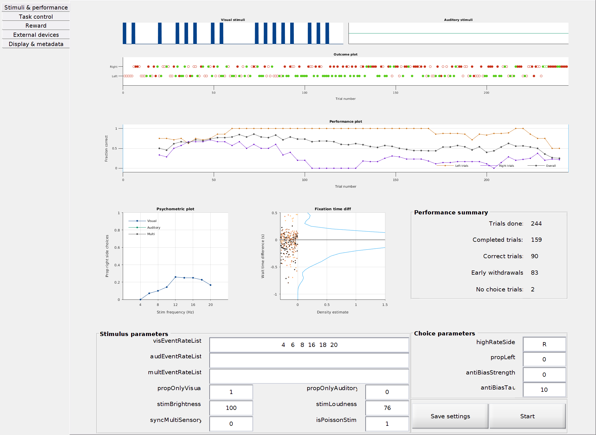

# chipmunk_solo

Freely moving auditory and visual discrimination task for mice (adapted from Raposo et al. 2012). *chipmunk_solo* is an adaptation of *chipmunk*, which can be found at https://github.com/churchlandlab/chipmunk.

## Introduction

This repo contains the code, setup description, assembly instructions, and parts design to build a freely moving behavior setup. The task is a visual and/or auditory accumulation of evidence task. The stimuli are stochastic ticks and/or flashes. `baseWait`, in the Experiment panel, is 0.5 s (the default) or 1 s. With `minWaitTime` set to `exp`, the mouse holds the center port for `baseWait` plus a random extra wait that averages 0.1 s. The `minWaitTime` staircase stops at `baseWait + 0.1`.

## Task window

Screenshots captured on Mercury. The performance view replays all 244 trials from recorded session GRB064 `20261030_151009`; the Task control view uses saved FakeSubject test settings.

The **Stimuli & performance** tab shows the stimulus, outcomes, performance and psychometric plots. The psychometric legend follows the three modality curves.



The **Task control** tab contains the state diagram, `baseWait`, fixation timing and trial delays.


### Check the psychometric plot

From the repository root, in a fresh MATLAB session:

```matlab
addpath('tests');
check_psychometric_plot;
```

This checks tabbed legend rendering, resizing, modality-specific probabilities and unequal frequency counts without connecting Bpod hardware.

## Setup instructions

You can find a spreadsheet with a parts list [here](hardware_setup/parts_list.xlsx). The designs for custom parts are in `/custom_parts`. If you have any doubts about how a certain part is supposed to look like refer to [this image of a finished setup](images/rig.jpg)

### A **condensed** step-by-step for building the setup:

1. Assemble enclosure onto a breadboard.
2. Assemble the LED panel.
3. Assemble the nose pokes.
4. Wire the cameras together and place in breadboard.
5. Assemble water delivery system. 

### A **detailed** description for building the setup:

1. Grab a breadboard big enough to place the behavioral enclosure, cameras, and any other additional equipment you might need. This will depend on the experiments specific needs.
2. Start assembling the behavioral enclosure and make sure there is enough distance between the breadboard and the bottom of the enclosure. This is to make sure that there is enough distance between a camera at the bottom and the bottom of the enclosure to visualize the subject in the experiment.
3. The back piece of the behavioral enclosure has openings for placing nose pokes and an LED board (to deliver experimental visual stimuli). Start by taking two rectangular pieces of acrylic, one of them being white and semi-transparent (the color and property of the other does not matter). You will now need to make four holes on the corners of each piece. Make sure these holes are aligned between the two rectangles since you will need to drive screws through both holes later on.
4. To assemble the LED board, grab the ALA LED flashboard and connect a second LED array to it. Fix the LED arrays on the non-white rectangular piece of acrylic. Then, take the white acrylic piece and make sure it fits in the rectangular opening on the back wall for the behavioral enclosure. Glue the white acrylic in place on the back wall. Now, join the two acrylic pieces (white piece glued to back wall and additional piece with the LED arrays) by threading a screw between the two pieces. Make sure to use spacers so that there is a space between the LED arrays and the back wall (this will allow for more light diffusion across the white piece).
5. To assemble the nose pokes, follow the instructions listed on `/hardware_setup/nose_poke_instructions.docx`.
6. To wire the cameras, follow the instructions found on https://github.com/jcouto/labcams/blob/main/camera_instructions.md.
7. To assemble the water delivery system, grab the solenoid valves and attach silicone tubing to two of the three protrusions (cover the third one with a black cap). One of the ends goes into a 50 mL syringe that will contain the liquid being delivered in the experiment (water in this case). The other end needs to go into a tapered needle that will be threaded through the nose poke to deliver the liquid in the syringe. Fix the syringes at an elevation where gravity can help the water travel since it's a purely passive system (the valve just opens and closes). You can take the valves and adhere them with tape or another type of removable adhesive to a something (leftover acrylic, etc.) that can help them stay in place and not be moving around or floating in the air. **Note: the water delivery system needs to be calibrated before experiments can begin. More on that later.**

### Additional details on purchasing equipment:	

- The walls are laser cut from [*pololu*](https://www.pololu.com/product/749).
- The designs for the visual and auditory stimuli PCBs (printed circuit boards) are found [here](https://github.com/churchlandlab/SpatialSparrow/tree/dev-couto/pcb/led_panel_split) and can be made through [*SeeedStudio*](https://www.seeedstudio.com).

### Camera usage details:

Use cameras that have GPIO connections like the FLIR Chamaeleon 3. On the Chamaeleon 3 you can use the purple wire (GPIO 2) for syncing the cameras. This will be necessary to receive TTL pulses from *Bpod* (more on this later) signaling the start and end of a trial on the camera's log file (see [labcams](https://bitbucket.org/jpcouto/labcams) for using the cameras in your experiments). 
	
## Software installation

Refer to instructions [here](/ubuntu_software_setup.md).

### Calibration 

#### Sensory stimuli
Instructions for calibrating the sensory stimuli are pending.

#### Liquid delivery
Within the Bpod control panel, click on the wrench icon, and select the water spout icon. This will take you to the water calibration panel. From there, select the valves you will calibrate and record at least three measurements (we use 30, 60, and 90ms with 300 repetitions). After calibrating, test curve (we use 4 microliters). You can also refer to the [official Bpod documentation](https://sites.google.com/site/bpoddocumentation/user-guide/general-concepts/liquid-calibration) on how to do this.

## Training strategy

A full training guide is available [here](https://grojasbowe.notion.site/Chipmunk-task-training-guide-ebe81437f5f14483b646d6c6ad3185f8).

By Lukas Oesch and Gabriel Rojas Bowe, circa 2024.
