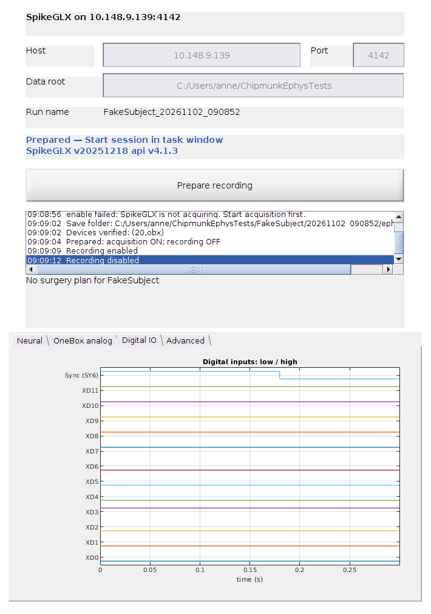
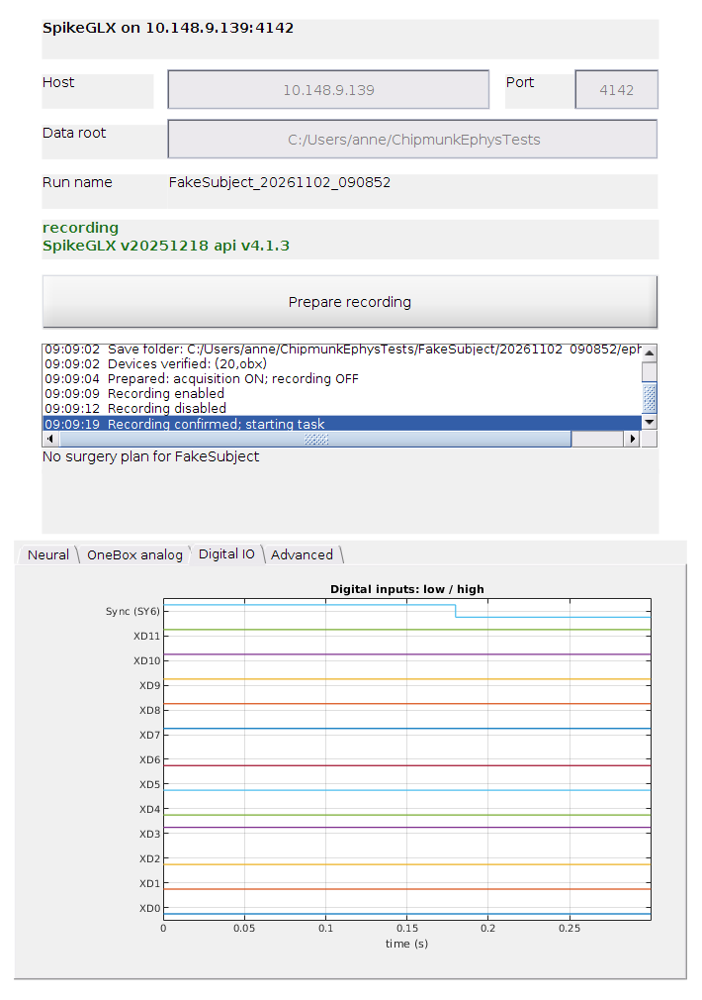
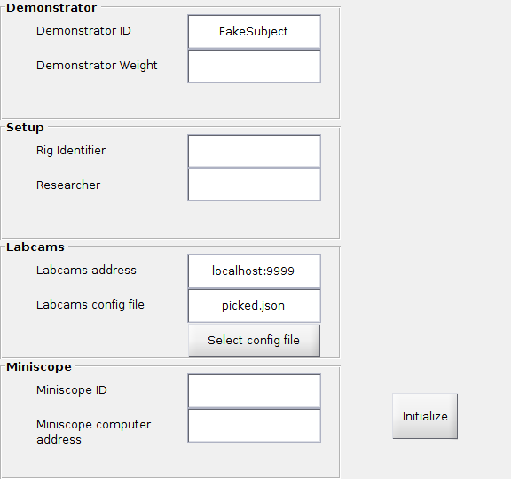

# chipmunk_solo testing and validation

Run every MATLAB check from the `chipmunk_solo/` folder in a fresh MATLAB session (`addpath('tests')`). Emulator checks need an idle `Bpod('EMU')` session. None of these establish physical LED, audio or TTL timing.

## On a rig, all at once

Before deploying a new version to a rig, run every automated check with one command (close MATLAB and stop any session first):

```sh
chipmunk_solo/tests/run_rig_checks.sh          # offline, emulator and real-Bpod checks (about an hour)
chipmunk_solo/tests/run_rig_checks.sh offline  # or one group: offline | emulator | real
```

Each check runs in its own fresh MATLAB on a temporary clone of the committed code, so the checkout is not touched. It prints PASS or FAIL per check and `ALL_PASS` at the end; logs and outputs go to `~/chipmunk-rig-checks/<time>/`. The `real` group takes over the Bpod port and, afterwards, leaves Bpod ready for auto-detection. The script's header lists the settings (Bpod folder, port, camera config) for rigs that differ from the defaults.

The checks below are what it runs, plus the ones that must be driven by hand (native file picker, historical equivalence).

## Task window

Check the psychometric plot:

From `chipmunk_solo/`, in a fresh MATLAB session:

```matlab
addpath('tests');
check_psychometric_plot;
```

This checks tabbed legend rendering, resizing, modality-specific probabilities and unequal frequency counts without connecting Bpod hardware.

## Stimulus manipulation

In a fresh MATLAB session, run the focused regression checks:

```matlab
addpath('tests');
check_stimulus_manipulation;
```

In a fresh, idle Bpod emulator session, run:

```matlab
addpath('tests');
check_chipmunk_manipulation_session(fullfile(tempdir, 'manipulation-session-check'));
```

This drives real GUI callbacks through eight visual FakeSubject trials: Standard, Dim, Long and Equalized, followed by eight passive replays. It checks saved parameter values, notes at trials 3/5/7, unchanged active records and reconstruction from source settings. It uses separate test output, synthetic calibration and no cameras or uploads. On Mercury (MATLAB R2022b Update 1, Bpod Console 1.71), the full run passed on 2026-11-01. That run exposed and fixed note helpers treating the live Bpod object as a struct and clearing active data on Update. The corrected run and focused regressions passed. MAT and notes downloads matched their source SHA-256 hashes.

Physical LED/audio/TTL timing and calibrated output are not established by emulation; Mercury emitted ALSA device/underrun warnings.

The [whole-task audit and validation record](audits/unified-task-2026-11-01.md) explains the cleanup, corrected bugs and remaining findings. Run `check_core_task` and `check_ephys` with the MATLAB checks above. Run real emulator suites in fresh sessions; the passive task can be checked with `check_chipmunk_replay_session(outputFolder, {'PassiveVisualStim'})`.

## Startup and repeated sessions

`check_startup` verifies validation, config quoting, complete GUI metadata and cancellation. `check_chipmunk_replay_session(outputFolder, experiments)` can run a list of consecutive active/passive sessions in the same MATLAB process. Its driver rejects late callbacks from deleted/replaced timers and checks that each session deletes its timer. A bounded natural-completion check is available as `check_chipmunk_replay_session(outputFolder, {'VisualTask'}, '', 3)`; normal Bpod launches still use the 5,000-trial default. Outcome plots stop indexing future trials after the final trial.

## Ephys

`check_ephys_workflow` checks Prepare/Start, delayed recording acknowledgement, failures, repeated names, run ownership and native GUI callbacks using an isolated SDK fixture. `check_ephys` checks that a blank host stays off and that a failed connect is stored rather than thrown. `check_spikeglx_devices` covers all 31 nonempty OneBox dock/XIO combinations and invalid addresses; `check_spikeglx_disconnect` checks failed-handle cleanup and explicit reconnect. `check_ephys_workflow` also covers live validated-device reuse, lost start acknowledgements, disconnected shutdown, recording-loss guards and camera rollback. `check_ephys_shutdown_order` executes the runner cleanup with isolated endpoints to verify that behavioral data is saved before camera/sound cleanup and ephys stops last, including save and sound failures. `check_stimulus_plot_parents` verifies that concurrent ephys redraws cannot steal the stimulus lines. These unit tests do not exercise neural hardware. Recorded-probe simulation and real SDK recovery evidence are in [the probe investigation](../tests/evidence/probe-integration-2026-11-02.json).

`check_ephys_anatomy` validates subject/probe/shank matching and command formatting; `python3 tests/check_vvasp_anatomy.py` independently checks coordinate transformations and physical distances. The Bpod preview requires no connected probe. Native SpikeGLX application still requires a compatible acquisition stream; physical-probe overlays remain unverified.

`check_ephys_digital` checks packed-bit decoding, signed words and empty/missing channels.

The revised Prepare/Start workflow passed a cold launch and two consecutive Mercury emulator sessions against Jupiter's XIO slot 20 on 2026-11-02: six saved active trials, three completed replays, recording confirmed before task Start, and four binary size/frame/SHA-1 checks. [Validation evidence](../tests/evidence/recording-workflow-2026-11-02.json) records the scope and limits. These native captures show recording off after preparation and on after Start session.





## Passive replay

Run the regression checks in a fresh MATLAB session:

```matlab
addpath('tests');
check_passive_replay;
```

These checks use controlled Bpod and sound-server doubles for lifecycle failures. They do not validate Bpod emulation or physical timing.

For real emulator checks, start a fresh, idle Bpod session with `Bpod('EMU')` (older Bpod versions also require clicking Start in emulation mode). Then run:

```matlab
addpath('tests');
check_passive_replay_emulator(fullfile(tempdir, 'replay-check'));
check_chipmunk_replay_session(fullfile(tempdir, 'replay-session-check'));
```

The first check runs replay through the real state machine and sound server, including Stop during ITI and playback. The second drives the full FakeSubject GUI and active trials, then checks disabled replay, enabled replay and another session. It uses temporary settings, synthetic sound calibration and local data; cameras and uploads are disabled. Physical TTL, LED, sound level and synchronization measurements remain separate. Bpod may discard raw events from an interrupted replay trial; its aborted status is still saved.

## Outcome and modality coverage

In an idle Bpod emulator, `check_chipmunk_outcomes(outputFolder, modality, correctSide)` runs five complete trials: correct choice, wrong choice, withdrawal during pre-stimulus fixation, withdrawal during stimulus fixation, and no-choice timeout. Use modality 1/2/3 for visual/auditory/multisensory and correctSide 0/1 for left/right. Each case checks the saved outcomes, choice validity, response side, reward accounting and visited states.

`check_chipmunk_manipulation_session(outputFolder, modality, syncMode)` runs Standard → Dim → Long → Equalized and replays all eight sources. The modality defaults to visual. For multisensory trials, syncMode 0 shuffles visual intervals, 1 synchronizes both channels, and 2 generates a fresh visual train. Dim and Equalized change visual brightness only; they do not change auditory amplitude. Reconstruction comparisons use controlled random state to compare rebuilt noise, not the original noise samples.

Use a fresh interpreter for each expanded coverage case. The later-session startup race was traced to waiting for a new UserData change after Initialize had already completed. Startup now waits for an explicit ready value; the combined six-session outcome batch passes. The earlier eight-session pass is retained as evidence for that sequence, not a universal repeated-start guarantee. The native file picker now has an actual mouse/keyboard Open/Cancel test. Physical output measurements require a recording return path.


## Native picker and endurance

On Mercury's X11 display, run `DISPLAY=:1 python3 tests/native_picker_input.py /tmp/chipmunk-picker-check` while a fresh MATLAB process runs `check_native_picker('/tmp/chipmunk-picker-check')`. Keep other plotting applications from taking keyboard focus during this test. The helper clicks Select config file, enters the JSON path, clicks Open, reopens and clicks Cancel, then clicks Initialize; MATLAB asserts the selected path remains correct. The test does not start cameras or Bpod hardware.

Camera commands use the `udpport` datagram interface (MATLAB R2020b or later). Labcams replies do not need a newline; startup probes time out quietly, while ephys recording still requires successful command acknowledgements. Run `check_labcams_udp` in a fresh MATLAB session to check real loopback datagrams, delayed log replies, server errors, missing replies and asynchronous logging.



In a fresh idle Bpod emulator, `check_chipmunk_endurance(outputFolder)` runs 1,000 actual trials through the real task, emulator, waveform generation, GUI plots and final save. It shortens pre-stimulus/required holds and inter-trial delays for stress testing; it does not substitute a fake event source or change the production defaults. Gabriel confirmed that mice stay below 1,000 trials, so this is the routine stress-test bound; the production task limit remains 5,000. The November 1 run was stopped at his request after 3,870 completed trials. Independent MAT readback verified all 28 checked trial fields, raw events and reward totals; the original 5,000-count harness assertion consequently failed after the successful save. A separate 100-trial run passed natural completion, idle-state and sound-server cleanup assertions. The long run used short holds/delays and was briefly paused during native picker testing.

The described hardware path is Bpod TTLs plus soundcard audio to speakers and visual output through a PWM driver to the LED board. These output connections have no recording return path. Software tests can check commands and waveforms; physical TTL/LED/audio onset and calibrated levels require a loopback or external sensor/instrument.


## Saved settings and Mercury rollout

`check_settings_compatibility(settingsFolder)` reads configured MAT settings, exercises the real GUI/Update/Save callbacks and saves only temporary files. It checks that existing values survive missing-default initialization and round trips; empty Bpod DefaultSettings placeholders are counted and skipped. Omit the argument to check the three shipped presets. For a rig inventory, provide an isolated directory containing copies of settings files only.

The [Mercury rollout and rollback guide](mercury-rollout.md) provides backups, candidate verification, a short emulator checkout and recovery steps. Production deployment remains separate from the temporary-checkout validation. Invalid replay Enable edits now record a failed replay and allow the completed active session to save. Alternate two-interval multisensory channels are padded with trailing silence for their 20 ms visual delay, and the stimulus plot displays their full duration.


## Historical task equivalence

For Standard Poisson trials with matching settings/calibration, direct source comparisons found identical stimulus samples in 135 cases per historical snapshot. The recent archived half-second task also matches all 18 compared state-machine cases, including LED commands. Reprocessing 1,343 recorded trials from July 2024 and October 2026 reproduces their saved outcomes, choices, rewards and wait-time calculations exactly. The source comparison passed on both local MATLAB R2024b and Mercury R2022b.

This is conditional equivalence. Older visual tasks used port LEDs, the original exponential task used a one-second baseline, and early training versions capped the numeric hold staircase at 0.5 rather than 0.6 seconds. Old assembler names also require an explicit mapping when reusing settings. See the [historical comparison record](audits/unified-task-2026-11-01.md#historical-task-equivalence) and [machine-readable evidence](../tests/evidence/historical-equivalence-2026-11-01.json).

Reproduce in a fresh MATLAB process before Bpod, with the three documented recorded MAT files available separately:

```sh
python3 tests/prepare_historical_comparison.py work/history-equivalence
```

Place the recordings under `work/history-equivalence/recordings`, then run:

```matlab
addpath('tests');
check_historical_equivalence(fullfile(pwd,'work','history-equivalence'),pwd);
```

The preparer retrieves pinned public source snapshots and extracts their actual stimulus/staircase blocks. The test captures state commands and sound buffers with controlled substitutes; it opens no devices. Animal recordings are not bundled. This does not measure physical output timing or establish exact historical noise realizations.
